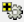

# Matrix Editor Update Baseline Objects Window

> 来源：PTC Windchill Help Center（R13.1.2.0）  
> 原文：[PTC Help Center](https://support.ptc.com/help/windchill/r13.1.2.0/en/Windchill_Help_Center/prodfamily/ProdFamMatrixEditorUpdateBaselineObj.html)  
> 获取日期：2026-11-12

Opens the **Update Baseline Objects** window, where you can update assigned revisions of module variants or parts that are associated with a variant baseline, or you can assign new baseline objects to the variant baseline. To update the variant baseline objects, use the following procedure:

When using multiple variant baselines:

1. Select multiple module variant or lower level part revision cells that span multiple variant baselines. Any selected configurable module or replacement part displayed in the part structure is ignored. If you select multiple revisions of the same module variant or lower level part, the highest revision is displayed as seed object. The **Target Variant Baselines** field displays the details of the targeted variant baselines that will get updated.

2. Define filter criteria to collect child parts of seed parts.

3. Select new revisions of the initially selected parts.

4. Collect child parts for seed objects. To selectively exclude objects to be updated as required, click the **Exclude selected objects**  icon. You can also control part collection by using the **Include dependent Parts** and **Include replacements** preferences. For more information on these preferences, see [Product Family Management Preferences](../../../../13-product-famil-9fdce8c5/02-product-famil-d963a369/index.md#wwID0EOZOU "Product Family Management Preferences").

5. Select the **Preserve Existing Revisions** check box to preserve existing revisions of variant baseline objects that are already assigned to variant baselines.

6. Verify updates in the **Preview Updates** step. This displays the parts being added or updated based on the part collection in the previous step for each of the target variant baselines. You can update or populate variant baseline member link attribute values in this step. You can also selectively exclude objects from the available updates list. The baseline member link attributes with the required value constraint are not automatically displayed in this step. You must manually include these attributes using the **Customize** view functionality.

7. Click **Finish** to apply updates.

When using a single variant baseline:

1. Select multiple module variants or lower level parts in the configurable structure. Any selected configurable module or replacement part displayed in the part structure is ignored. The selected seeds are displayed in this step with the same revision that you selected while launching this window.

2. Define filter criteria to collect child parts of seed parts.

3. Select new revisions of the initially selected parts.

|  |  |
| --- | --- |
| **** | You can change the revision of the seed objects. However, you cannot complete the **Update Baseline Objects** action until dependent parts are re-collected. |

4. Collect child parts for seed objects if the **Include dependent Parts** preference is set to **All**, or if you have selected **All** from the **Dependents** drop-down menu in this window.

5. Collect related parts based on the setting for the **Include replacements** preference. You can also collect replacements for the selected parts by clicking the **Collect replacements**  icon.

6. Select the **Preserve Existing Revisions** check box to preserve existing revisions of variant baseline objects that are already assigned to a variant baseline.

7. Verify updates in the **Preview Updates** step. This displays the parts being added or updated for the part collection in the previous step. You can update or populate variant baseline member link attribute values in this step. You can also selectively exclude objects from the available updates list. The baseline member link attributes with the required value constraint are not automatically displayed in this step. You must manually include these attributes using the **Customize** view functionality.

8. Click **Finish** to apply updates.

As a result, existing variant baseline members are updated and new variant baseline members are assigned as appropriate.

>  **Note:** • A separate set of seed objects is maintained for each context variant baseline.• If the same part is selected as seed object for multiple context baselines, the same revision of the seed part gets associated with all the relevant context variant baselines.• You cannot associate different part revisions with different context baselines even though the **Update Baseline Objects** window maintains a separate set of seed objects for each context baseline. This is because only one part structure is displayed for a seed part in the first step of updating baseline objects process.• You must select an empty cell for a context variant baseline to add it to a new context variant baseline. For example, if you want to add a part to two different variant baselines, select two empty cells for that part for the corresponding variant baselines.• Dependent parts (both replacement and dependent parts) if collected by the user, get associated with the context variant baselines for which the parent or seed part is selected.
