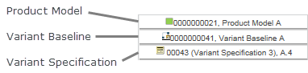

# Matrix Editor Variant Specification Table

> 来源：PTC Windchill Help Center（R13.1.2.0）  
> 原文：[PTC Help Center](https://support.ptc.com/help/windchill/r13.1.2.0/en/Windchill_Help_Center/prodfamily/ProdFamilyMatrixEditorProductVariantTable.html)  
> 获取日期：2026-11-12

The variant specification table presents columns for each variant specification that has been selected in the product family pane. Each variant specification column contains several headers to indicate which variant specification is described in the column, what product model the variant specification belongs to, and if it is associated with a variant baseline, then a column header for the variant baseline is also displayed. The following graphic is an example of these column headers.

If a product model or variant baseline header applies to more than one variant specification columns, then the header spans all of the applicable variant specification columns. For example, if a variant baseline has multiple variant specifications associated with it, then the variant baseline column header in the matrix editor extends across the columns for those variant specifications in the variant specification table.

Use the configurable structure table to cross-reference with the variant specification. For each configurable part and configurable module listed in the configurable structure, a corresponding cell for that part appears in the variant specification column. The following glyphs display within the module variant cell to indicate the status of the module variant in relation to the variant specification.

| Glyph | Description |
| --- | --- |
| <empty> | The cell is for a configurable module that is included for a variant specification and uses option filtering for its children. |
|  | The cell is for a configurable module that is excluded for a variant specification due to option or manual selection filtering, orThe cell is for a module variant that is in an excluded branch of the part structure for the variant specification, orThe cell is for a lower-level part or a replacement part that is in an excluded branch of the part structure for the variant specification. |
|  | The cell is for a configurable module that is in an excluded branch of the part structure for the variant specification. |
|  | The cell is for a module variant that is selected for a variant specification due to option filtering. |
|  | The cell is for a module variant that is included for a variant specification due to manual selection filtering. |
|  | The cell is for a lower-level part that is in an included branch of the part structure for the variant specification. |
|  | The cell is for a module variant that is excluded due to an upper-level option filtering excluding the sub-tree. |

## Matrix Editor Part Cell Information

The information that the matrix editor displays for a part depends on whether a revision of the part is associated with a variant baseline.

If a lower-level configurable module has not been filtered for a variant specification, then all of the optional parts possible for the configurable module are indicated as applicable to the variant specification, and a green check mark icon appears in the variant specification’s corresponding cells for those parts based on either assigned expressions or manual selection.

If a revision of a part has been associated with the variant baseline, then the part information for that revision is shown in the part’s cell in the variant specification column. For example, the part revision status is included. If the revision is locked in the variant baseline because its status has reached In Assembly, then the locked icon  is also displayed. The revision indicates the part revision’s status relative to its development status in the variant baseline.

If a revision of the part is associated with the variant baseline, then the part’s cell in the variant specification column displays the part version based on the current In-Session configuration specification.

You can configure the display of attributes either vertically or horizontally as a comma-separated list by setting the **Default attributes layout** preference under **Display** > **Product Family** > **Matrix Editor**.

Also, you can configure the width for product variant columns by setting the **Default column width** preference under **Display** > **Product Family** > **Matrix Editor**.

## Viewing and Updating Revision Rows when using Multiple Variant Baselines

When using multiple variant baselines, you can view the selected and latest revisions on the module variants on separate rows.

The selected revisions and the associated part version attributes are available only when using multiple variant baselines. You can edit these part version attributes inline for the displayed revision rows in the Product Structure tree. However, you cannot edit the part version attributes directly in Matrix area cells. In Matrix area cells, you can edit only the variant baseline member attributes.

>  **Note:** • You must have the Modify permission to make attribute changes to any specific revision. Also, the part version that you are editing must be checked out either automatically or manually.• You can also edit modeled part version attributes in the Product Structure tree.• When the part version attributes are edited, the corresponding duplicate revision rows are also updated within the Product Structure tree.• In Matrix area cells, you cannot edit Plan attributes (Deadline and Health Status), because these attributes are derived from the plan and not from the part structure.

You can also edit variant baseline attributes either in the master row cell or in the revision row cell. However, part master and part usage attributes are not displayed when the revision rows are displayed.

To inline edit the substitute part details such as quantity, unit, and reference designator, enable the **Enable quantity and reference designators for substitute parts** preference under **Part Management**.

To initially display the configurable product structure with module variant revision rows, enable the **Automatically Show Selected Revision in Matrix Editor** preference under Display > Product Family > Matrix Editor. This adds rows as children to the module variant master. One row is displayed for each revision of the selected module variant, and one additional row is displayed for the latest version of the module variant.
