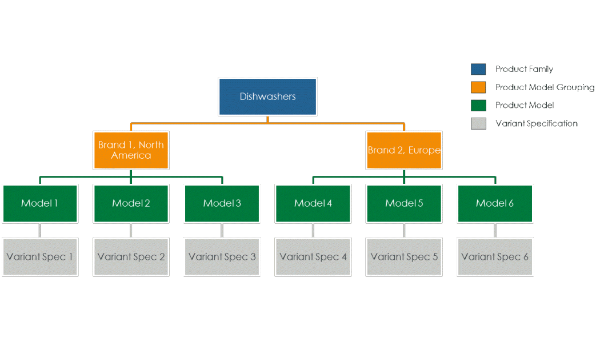
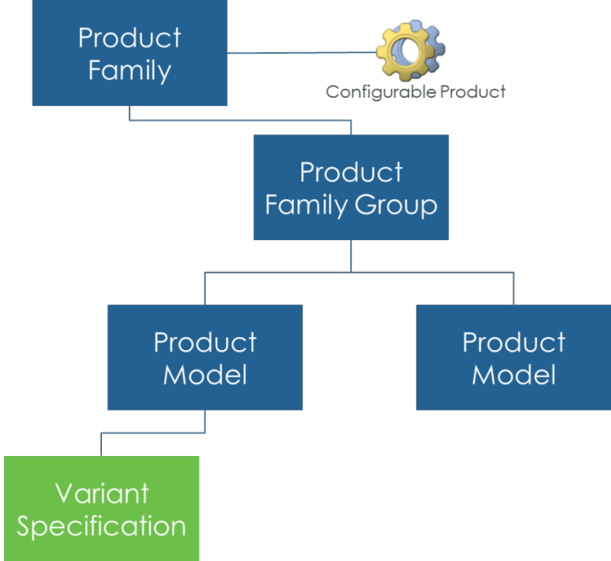

# Product Family Management

> 来源：PTC Windchill Help Center（R13.1.2.0）  
> 原文：[PTC Help Center](https://support.ptc.com/help/windchill/r13.1.2.0/en/Windchill_Help_Center/prodfamily/ProductFamilyManagement.html)  
> 获取日期：2026-11-12

Configurable Platforms are used to meet a diverse set of market needs while emphasizing reuse. This can help an organization to get to the market faster, increase engineering and manufacturing efficiency while improving quality and customer satisfaction. There are several common patterns that can be used when leveraging configurable platforms to plan out offerings for a market. These include planning out specific market offerings in the case of Assemble-to-Stock (ATS) products, planning common configurations for Assemble-to-Order products or a series of representative configurations of commonly selected choices. These can be used to plan what features to offer to a market, to validate these offerings and to provide downstream groups such as manufacturing and service insight into production and support needs.

It is common to represent a group of offerings for the market for a configurable platform that represent what will be available for the market over a period of time such. These offerings can be grouped based on how they are sold such as under different brand names, feature levels, price levels or other needs. Frequently, such a series of offerings is called a Product Family. Windchill Product Family Management provides the ability to describe a Product Family based on a configurable product.

The Product Family is a grouping of planned products that are similar but use a range of different choices to meet a broad set of market needs. Individual products or market offerings of a Product Family are built on a common product platform (configurable product) leveraging module variants that are selected based on the logic defined for that platform.

Product Family Management enables building of a family of products against a configurable product based on the Options and Variants capability. This starts with the Product Family top level that is associated with a configurable part that it represents. A Product Model is used to define the product or offering that is made available to the market or used to represent and validate a common set of offerings. Product Models can be organized using Product Model Groups. These Product Model Groups can be used to show different branding, feature alignment, or other market needs.

Product Families can be used to facilitate a top-down design process for products, where product models can be planned and managed separately from parts engineering. Design of parts that are required to complete variants of a product model can be planned to occur at a later point in the design process. A Product Family structure speeds up the product development by reusing an existing Product Model structure for the next iteration of the product, with small updates to the components that are required for the new Product Model.

Variant specifications capture the selected features (choices) to define the configuration of the Product Model that they are related to. This can be represented as one-to-many variant specifications.

With the Product Family defined, there is the ability to manage and view Product Models using Matrix Editor. The Product Family Matrix Editor is a tool that allows you to view, compare, and define Product Models and variant specifications in a convenient matrix user interface. This view gives a clear overview of the Product Family as planned, enabling the understanding of where the module variants are reused in an easy-to-view format. This allows the organization quick access to view the entire range of a Product Family as it is planned to go to the market and as it is maturing throughout its lifecycle.

In addition, Product Family Management facilitates prototype development and management. Variant baselines can be used with the Product Family definitions to manage the development of prototypes and validation of variant specifications. A variant baseline can be captured for a specific configuration of a product structure to use for manual prototype assembly and validation. These variant baselines when used with Product Families allow you to capture the progression of a Product Model through several phases of prototype development and maturity.

There are some key differences in how you can use the Product Family capabilities for Platform Planning or for Prototype development. The following table lists some of the examples:

|  | Platform Planning | Prototype Management |
| --- | --- | --- |
| Variant Baselines | Typical to use Latest or Effectivity for Family configurations | Can be used to track specific module variant revisions |
| Single Variant Specification View (Full Structure) |  |  |
| Multiple Variant Specification View – Common Configuration specification (Down to Module Variants) |  |  |
| Multiple Variant Specification View – Variant Baselines (Down to Module Variants) |  |  |

Product Families can be created in **Product**  and **Library**  application contexts. Product Families are listed in the [Product Families Table](01-product-family-673356/03-product-families-table/index.md#wwID0EZKYT "Product Families Table") on the application context’s information page.

## Related Links
